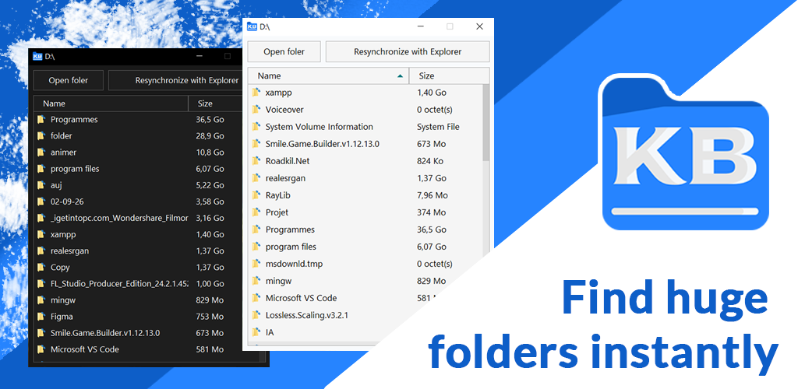
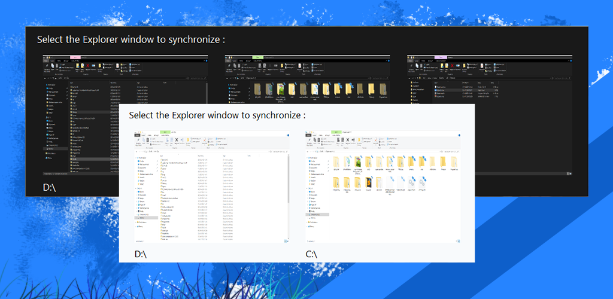
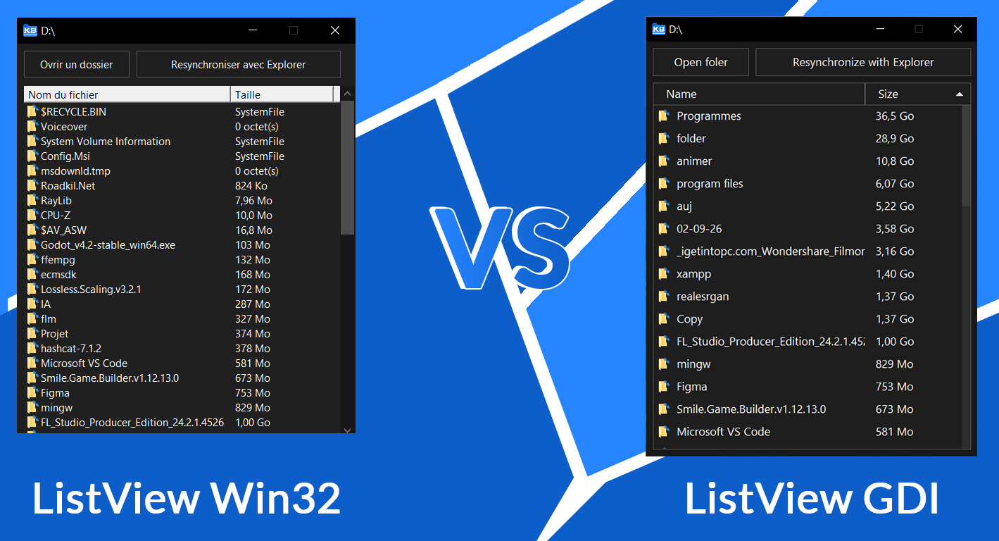
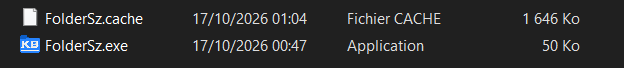

# FolderSz

**A portable Windows utility for analyzing folder sizes, with a
lightweight interface and a cache designed to avoid unnecessary
recalculations.**

FolderSz is a native Windows application written in C using the Win32
API. It presents folder sizes through a simple interface while reducing
repeated work with a persistent cache.




## Table of Contents

-   [Features](#features)
-   [What Makes FolderSz Different](#what-makes-foldersz-different)
-   [Technologies](#technologies)
-   [Design Decisions](#design-decisions)
-   [Usage and Portability](#usage-and-portability)
-   [Building](#building)
-   [Project Structure](#project-structure)
-   [License](#license)
-   [Author](#author)

## Features

-   Scans folders and calculates their sizes.
-   Caches results to avoid recalculating previously processed data
    unnecessarily.
-   Looks up cached entries using a hash of the folder path.
-   Uses a native Windows interface with application-drawn components.
-   Adapts the display to the screen's DPI settings.
-   Organizes and compares results, including sorting.
-   Synchronization with Explorer

## What Makes FolderSz Different

### A cache designed to reduce repeated work

Recursively calculating a folder's size can require traversing many
files and subfolders. FolderSz uses a cache to reuse available results
instead of repeating the same work every time.

The cache uses:

-   **FNV-1a 64-bit** to hash folder paths;
-   **a bitmask** to track cache slot states;
-   **linear probing** to find available slots and handle slot
    collisions.

These mechanisms are designed to keep the cache compact and lookups
efficient. Actual performance depends on factors such as the number of
folders, storage performance, and cache state.

### Synchronization with Windows Explorer windows that are already open

FolderSz can retrieve the folder path currently displayed in an already 
open File Explorer window. This allows you to quickly select a folder you 
are already viewing, without having to navigate through the directory 
tree all over again



## Technologies

-   **Language:** C
-   **Platform:** Windows
-   **System API:** Win32
-   **UI drawing:** GDI
-   **Path hash:** FNV-1a 64-bit
-   **Supported build environment:** Visual Studio 2022
  
## Design Decisions

### A custom-drawn interface using GDI

FolderSz does not rely on native Win32 controls for every part of its
interface. Some components are drawn directly with **GDI** to provide
more control over the appearance, especially in dark mode, and to create
a more modern, consistent interface.

The native `ListView` presented dark-mode styling challenges and did not
fully match the intended design. Rather than adding more workarounds
around the native control, FolderSz uses an application-drawn virtual
list and custom-drawn buttons. This gives the application direct control
over rendering, colors, visual states, and interactions.



This design also aims to provide a responsive, fluid interface without
embedding a web UI runtime. Smoothness is a design goal; actual
performance depends on the machine, data volume, and operations being
performed.

### A compact cache using FNV-1a

Storing every folder's full path would require a significant amount of
memory. A Unicode path with the Win32 `MAX_PATH` limit of 260 characters
can require up to **520 bytes** for the path text alone when represented
as UTF-16, before accounting for other cache-entry fields.

FolderSz therefore stores a **64-bit FNV-1a hash (8 bytes)** instead of
the full path. This greatly reduces the space used to identify a folder
in the cache.

This is a deliberate trade-off. A hash provides a compact identifier but
does not preserve the original path. As a result, the cache cannot
always detect when a file or folder has been deleted or renamed.
Depending on changes made to the filesystem, some entries may become
stale, so the cache may need to be cleared manually from time to time.

The cache file is named **`FolderSz.cache`** and is created next to the
executable, making it easy to locate and delete when a reset is needed.

### Hash collisions: a known limitation

FNV-1a 64-bit produces an 8-byte hash. Like any fixed-size hash,
collisions are theoretically possible: different paths can produce the
same hash. FolderSz uses **linear probing** to handle collisions between
occupied slots in the hash table.

The project has a stated maximum capacity of **312,083 folders**. At
this scale, a hash collision between two distinct paths remains
theoretically possible and should not be described as impossible. The
probability depends on factors including hash distribution and the
number of entries. Linear probing handles slot collisions, but by itself
it cannot distinguish two different paths that produce exactly the same
hash when the original paths are not stored. This limitation is part of
the trade-off between a small memory footprint and folder
identification.

### A native Windows application

FolderSz uses C and the Win32 API, with GDI for its custom-drawn
components. This keeps rendering and interactions under the
application's control without embedding a web UI engine.

## Usage and Portability

FolderSz is designed to be **portable** and does not require a
traditional installation. Run the executable from a directory of your
choice.

The `FolderSz.cache` file is created next to the executable. To reset
the cache, close FolderSz and delete this file. It will be recreated the
next time the application starts. Clearing the cache means that data
will need to be recalculated during subsequent scans.



## Building

### Requirements

-   Windows
-   Visual Studio 2022
-   The **Desktop development with C++** workload installed in Visual
    Studio, which provides the Windows C/C++ build tools

### Steps

1.  Clone or download the repository.
2.  Open `FolderSz.sln` in Visual Studio 2022.
3.  Select the desired configuration, such as `Release`, and the
    appropriate platform, such as `x64`.
4.  Build the solution using **Build \> Build Solution**.

The file names and configurations above should match those included in
the published repository.

## Project Structure

Source files (`.c`) and header files (`.h`) are separated while
retaining the same responsibility-based groups:

``` text
FolderSz/
├── src/
│   ├── main.c
│   ├── pch.c
│   ├── platform/       # Windows and Win32 implementation
│   ├── core/           # Application logic, scanning, and cache
│   └── ui/             # Drawing and UI component behavior
├── includes/
│   ├── type.h
│   ├── pch.h
│   ├── platform/       # Headers for platform modules
│   ├── core/           # Headers for core modules
│   └── ui/             # Headers for UI modules
├── LICENSE
├── README.md
└── FolderSz.sln
```

This separation makes source implementations and declarations easier to
locate while preserving the organization by responsibility. The tree
should match the actual directory layout in the published repository.

## License

FolderSz is distributed under the **MIT License**. See the
[`LICENSE`](LICENSE) file for the complete terms.

The license permits use, modification, and redistribution, including in
commercial projects, provided its conditions are met. These include
retaining the copyright notice and license text in copies or substantial
portions of the software.

## Author

Created by Joss HR.

-   GitHub: [FullJoss](https://github.com/FullJoss/)
-   Repository: [FolderSz](https://github.com/FullJoss/FolderSz/)
